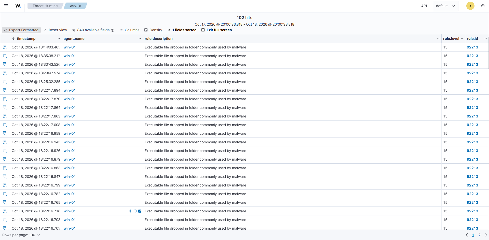
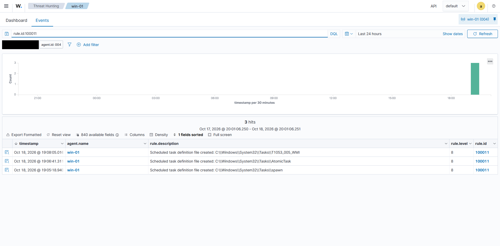

# SOC lab con Wazuh: dall'attacco simulato all'alert

Un laboratorio personale di detection. Emulo tecniche MITRE ATT&CK su Windows 11, guardo cosa rileva Wazuh, scrivo e provo le regole che mancano e ricostruisco un incidente a partire dagli alert.

**In English:** a personal detection-engineering lab. I emulate MITRE ATT&CK techniques on Windows 11 with Atomic Red Team, check what Wazuh and Sysmon detect, write and test the rules that are missing, and investigate an incident from the alerts alone. The documentation is in Italian.

## In 30 secondi

| Cosa | Risultato |
|---|---|
| Tecniche ATT&CK emulate | 5: PowerShell, attività pianificate, chiavi Run, account locali, cancellazione dei log |
| Rilevate da Wazuh di default | 3 su 5. Due lacune: le attività pianificate non generano nessun alert; la cancellazione dei log arriva solo a livello 5 e non sul processo |
| Regole personalizzate | 5 (100010-100014): 4 chiudono le lacune, 1 riduce un falso positivo. Tutte provate dal vivo, ognuna con un controllo negativo |
| Indagine | 1 [report di incidente](docs/incident-report-01.md) ricostruito dai soli alert |
| Altro | 3 regole tradotte in Sigma, un layer di ATT&CK Navigator, 7 alert reali ripuliti, 12 schermate |

Strumenti: Wazuh 4.14.8, Sysmon, Atomic Red Team, Sigma, ATT&CK Navigator. Windows 11, Linux, Proxmox, VirtualBox. PowerShell, Python, XML.

## Cosa mostra
- **Trovo le lacune.** Per le attività pianificate Sysmon registrava tutto e Wazuh non segnalava niente. Ho scritto io le regole 100011 e 100012.
- **Verifico le ipotesi.** Pensavo che 100 falsi positivi avessero la stessa causa. Contandoli erano 11 contro 89, e ho abbassato di livello solo il caso certo.
- **Indago e documento.** Il report di incidente ha timeline, domande di triage, indicatori e verdetto, e dice anche cosa non so.

## Da dove leggere
- **5 minuti:** il [report di incidente](docs/incident-report-01.md) e il [write-up 03](writeups/03-falso-positivo-92213-psscriptpolicytest.md).
- **15 minuti:** [detections/README.md](detections/README.md) (una riga per tecnica) e le regole in [local_rules.xml](detections/local_rules.xml).
- **Per rifare il lab:** [docs/procedure.md](docs/procedure.md). La mappa completa del repo è in [STRUTTURA.md](STRUTTURA.md).

## Risultati

| Tecnica | Test | Alert di default | Regola mia |
|---|---|---|---|
| T1059.001 PowerShell | 17, 15, 10 | 92057, 92071, 92041 (livelli 10-12) | 100010, per ridurre il falso positivo 92213 |
| T1053.005 Scheduled Task | 2, 4, 6 | nessuno sulla creazione dell'attività | 100011, 100012 |
| T1547.001 Run Keys | 1, 2 | 92302 (livello 6), 92041 (livello 10) | nessuna |
| T1136.001 Account locale | 4, 5 | 92040 (livello 12), 60109 (livello 8) | nessuna |
| T1070.001 Cancellazione log | `wevtutil cl` a mano | 63104 (livello 5), ma il processo non viene segnalato | 100013, 100014 |

Il dettaglio di ogni prova è in [detections/README.md](detections/README.md) e in [docs/procedure.md](docs/procedure.md). Le schermate in `evidence/` sono ritagliate e con nomi e dati personali coperti.

## Due casi

**Il 92213 e l'ipotesi sbagliata.** La regola 92213 (livello 15, "eseguibile creato in una cartella usata dai malware") scattava a ogni avvio di PowerShell. Ho contato gli alert: 100 in poco tempo, solo 11 sul file di prova che PowerShell crea da solo e 89 dagli script del modulo di test. Ho abbassato di livello solo il caso di cui ero certo (regola 100010) e ho lasciato gli altri 89, perché sono rumore del test e non volevo nasconderlo. Racconto nel [write-up 03](writeups/03-falso-positivo-92213-psscriptpolicytest.md).

**La telemetria c'era, la rilevazione no.** Sysmon registrava ogni evento delle attività pianificate, ma nessuna regola li interpretava. Ho agganciato la 100011 al file di definizione che Windows crea in `System32\Tasks`, l'unico punto in comune tra i tre metodi di creazione provati, e ho aggiunto la 100012 sul comando `schtasks /create`. Racconto nel [write-up 04](writeups/04-lacuna-t1053-005-scheduled-task.md).

Gli inciampi pratici (ID 100001 già usato, `grep -a` su `alerts.json`, timeout dell'indexer al boot) sono nella [procedura](docs/procedure.md) e nel [write-up 02](writeups/02-indexer-timeout-al-boot.md).

## Il laboratorio

| Host | Tipo | Ruolo | Gruppo Wazuh |
|---|---|---|---|
| wazuh-mgr | VM Linux Mint su Proxmox, 4 vCPU, 8 GB | manager, indexer, dashboard | - |
| win-01 | VM Windows 11 su VirtualBox, 8 vCPU, 8 GB | vittima, Sysmon, Atomic Red Team | lab |
| prod-01, prod-02 | PC Windows 11 di casa | solo monitoraggio, non li attacco | default |

Versioni: Wazuh 4.14.8, Sysmon 15.22 con la configurazione di SwiftOnSecurity, modulo Invoke-AtomicRedTeam. I test girano solo su `win-01`; i due PC di casa mi servono per capire quanto rumore farebbero le regole su un uso normale. Nel repo non c'è nessun malware funzionante: solo descrizioni, comandi pubblici dei test, regole e schermate. Dettagli in [docs/architecture.md](docs/architecture.md).

## Limiti
- Una sola VM Windows, una baseline di circa 3 ore (738 alert, il 67% dalla scansione SCA), nessuna fase con C2.
- Le regole nuove le ho osservate per pochi minuti: non so ancora quanti falsi positivi producono in un uso normale prolungato.
- Un solo controllo negativo per regola, eseguito una volta, e nessuna variante di evasione provata.
- `Clear-EventLog` di PowerShell non ha una regola sul processo: lo copre solo la 100013, come effetto.
- Il lab non è isolato dalla rete di casa: la NAT di VirtualBox blocca le connessioni in ingresso, non quelle in uscita.
- Il report di incidente usa una sola fonte, `alerts.json`, e non i log grezzi.

Collegati: [STRUTTURA.md](STRUTTURA.md), [detections/README.md](detections/README.md), [docs/incident-report-01.md](docs/incident-report-01.md).
